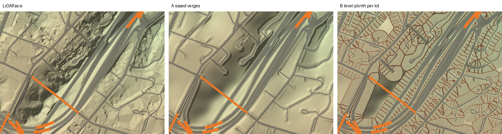
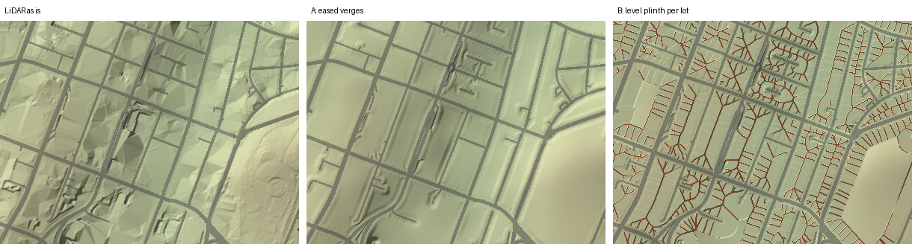
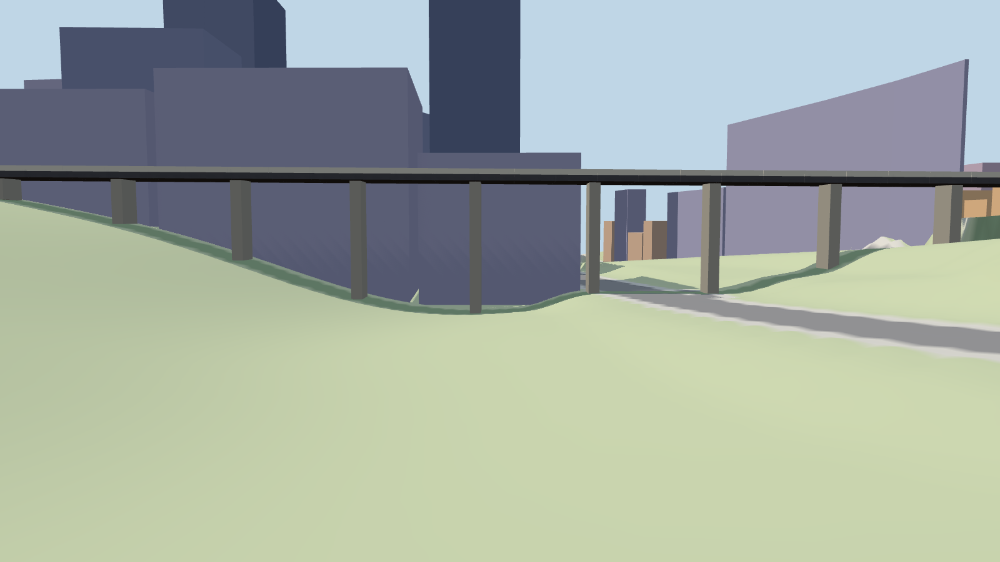
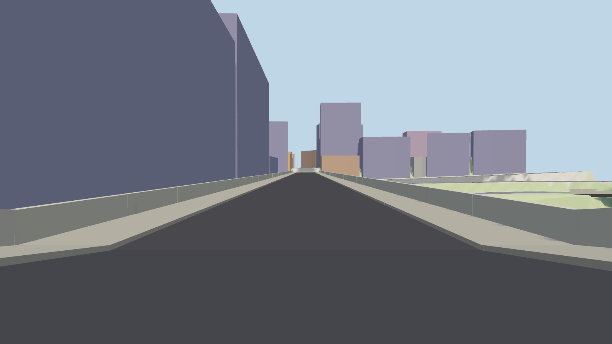
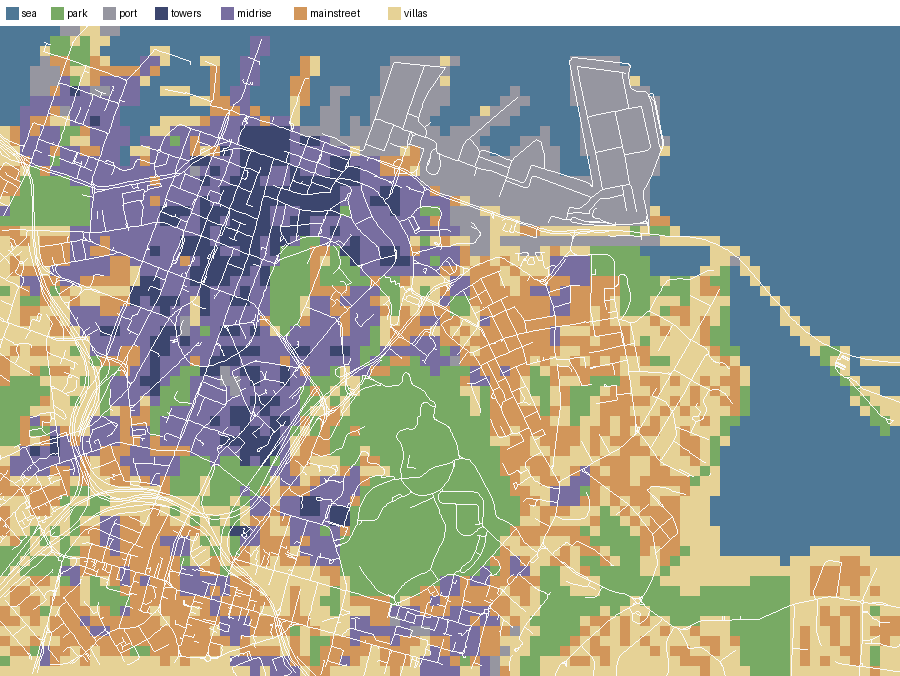
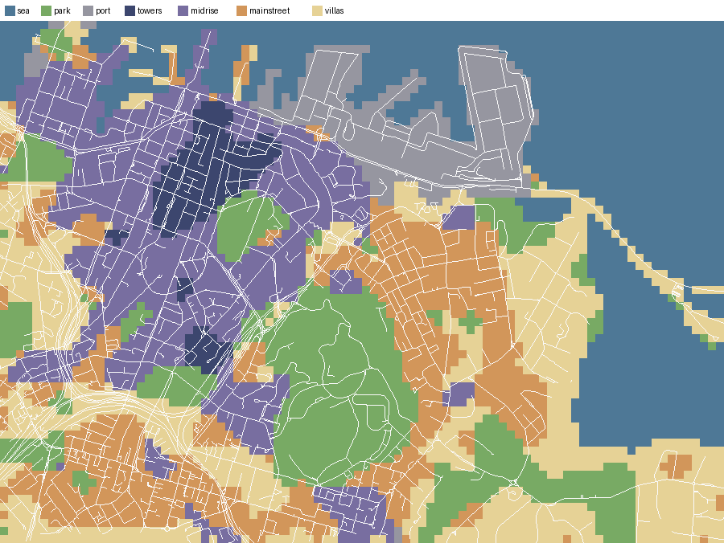
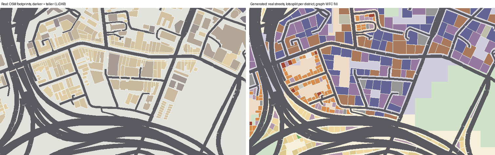
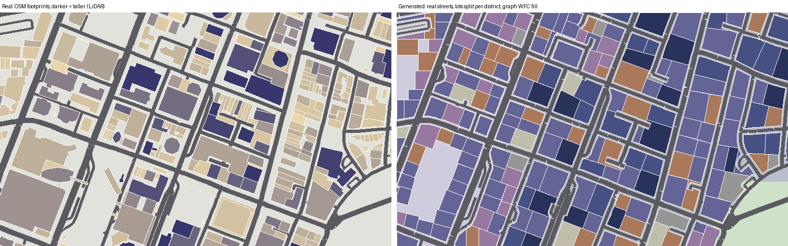
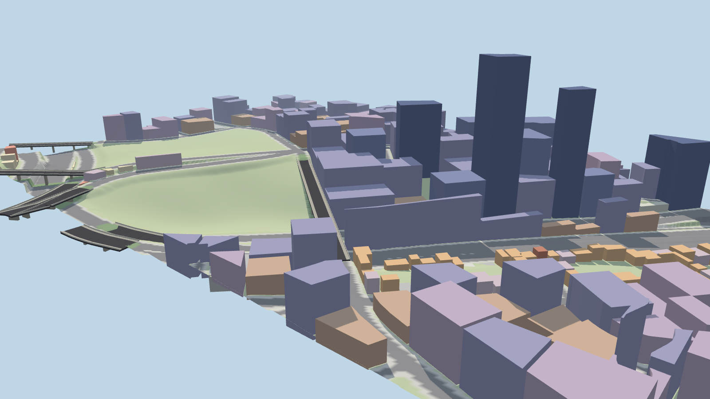

# World gen: real Auckland as the brief, not the blueprint

An exploration, for discussion before any of it is built. Fresh thinking: none
of the current generator is reused (the lab only reads the same raw inputs: OSM
and the LINZ LiDAR). The prototypes are in `tools/worldgen-lab/` and every
picture here comes from them.

## The problem, as I see it

The current generator copies the city at the **wrong scale**. It uses the data
at 1–2 m, where it is noisiest: kerbs, retaining walls, driveways, LiDAR
holes under bridges, OSM quirks. That is also the scale the car drives on.
The scale that makes the place *feel* like Auckland costs little to keep: the
Queen St valley, the K Rd ridge, Grafton Gully, the waterfront, the skyline
and a dozen landmarks.

Measured on today's map (`tools/worldgen-lab/diagnose.ts`, which samples the
shipped heightfield across every road-graph edge):

| | share of road length |
|---|---|
| tilted sideways more than 6% | ~9% |
| tilted sideways more than 12% | ~3.5% |

So the proposal: **keep the real data at coarse scale and as hints, and
generate the fine scale from rules**, the way Minecraft builds a world from a
few smooth fields plus local rules. Roads keep their real layout. Their
heights, the ground around them and everything on the blocks are designed.

## A pipeline in stages (Minecraft-shaped)

Minecraft generates a chunk in fixed stages: noise fields → terrain shape →
surface → carvers → structures → features. Each stage reads only the stages
before it and nearby chunks, from a seed. Ours would be:

| Stage | Reads | Makes | Real data's role |
|---|---|---|---|
| 0. Fields | LiDAR, OSM land use | macro relief, district map, coastline, green | **distilled** to ~50 m |
| 1. Skeleton | OSM roads, fields | road graph with designed heights, bridges, junction plates | layout kept exactly, heights as targets |
| 2. Ground | skeleton, relief | heightfield built around the roads | relief only |
| 3. Blocks | skeleton, districts | blocks → lots → level plinths | none |
| 4. Fill | lots, districts | buildings per lot (graph WFC), landmarks pinned | **soft prior** (LiDAR heights bias choices) |
| 5. Features | everything | trees, furniture, parked cars, park paths | density hints |

Stage 0 is small enough to **hand-edit**: a 90 × 65 pixel district PNG and a
smooth relief grid. That's where "informed by the real city, but cohesive"
lives: the data gives a first draft of the fields, you paint over it, and
everything downstream follows.

---

## Idea 1: Designed road profiles (prototyped)

Every road-graph vertex (junctions, plus one every 8 m along each way) gets
its height from **one sparse least-squares solve**:

- stay near the bare earth under the road (LiDAR, lightly smoothed),
- smooth vertical curves (second differences along each way),
- each junction is a tilted **plane** that its arms leave tangentially,
- bridges have no ground term, so they span straight between abutments,
- a grade cap (12%), enforced by re-solving with the over-steep steps pinned
  (active set), so capping one steep street doesn't drag its neighbourhood away.

The road surface is then **level across** every way (zero cross-slope), with
junction plates blended into the arms over 10 m.

Results on the full CBD (3,904 edges, 30k profile vertices, 1,575 junctions;
~40 s in Python):

| | p50 | p90 | p99 | > 6% |
|---|---|---|---|---|
| cross-slope, LiDAR as-is | 1.8% | 7.6% | 35.7% | 14.4% |
| cross-slope, designed | 0.0% | 0.0% | 2.5% | 0.5% |

Grade: capped at 12% (1,352 steps pinned at the cap, max residual 14%). Road
heights move from the LiDAR by 2 cm at the median and 1.4 m at p99. Grafton
Bridge comes out a straight 0.7% deck from 67.7 m to 65.9 m.

What's left: junction plates tilt 4% at the median but up to 18% (needs its
own cap), and the motorway interchange in Grafton Gully needs care
(stacked ramps, dual carriageways).

## Idea 2: Ground built around the roads (prototyped, two variants)

Minecraft adapts terrain to its structures (the "beardifier"); here the roads
are the structure. Off-road ground is either:

- **A: eased verges.** It blends from the nearest road's height back to the
  macro relief (the LiDAR smoothed at σ 22 m) over 14 m. Smooth and natural.
  Hills keep their shape, the noise goes.
- **B: level plinth per lot.** Every ~18 m of frontage, on each side of each
  street, is a level pad at its kerb height, with retaining walls between
  pads. Steep streets read as stepped shopfronts (very Auckland: Parnell Rise,
  Victoria St West), and every building stands level by construction.




(Orange: bridge decks. Brown lines in B: retaining walls between pads. Plinth
lots in the prototype come from the frontage alone; in the real pipeline the
lots from idea 5 would define them.)

My pick: **A everywhere, plus B under buildings.** Parks and open ground
ease, lots get pads.

In the game, a road that is level across is a plane locally, so it can be its
own collider strip (planar quads) laid exactly on the drawn surface, with the
heightfield underneath for everything else. That removes the 2 m blur at road
edges, and the stack of lifts, sinks and tolerance bands that draping needed.
It also makes real 15 cm kerbs possible if we want them.

## Idea 3: A bridge and structure kit (prototyped in the preview)

Bridges stop being "ground that's missing" and become **a cross-section swept
along the designed profile**: carriageway, kerbs, footpaths both sides,
parapets, piers down to the ground every ~25 m, abutments that meet the
ground. Colliders are boxes per span, so a bridge is as easy to drive as the
road either side. The same kit covers flyovers, motorway ramps, car-park
ramps, wharves and pontoons (deck plus piles), and tunnel or underpass
portals.




## Idea 4: Districts as biomes (prototyped)

Real data distilled to a few channels on a 50 m grid: building cover, typical
building height (LiDAR DSM − DEM), green, industry, houses. These are
classified into seven districts (sea, park, port, towers, mid-rise, main
street, villas), then cleaned up with a majority filter so districts are
cohesive patches rather than a building-by-building copy.

| Raw classification | Cleaned (3 passes) |
|---|---|
|  |  |

The classifier is rough: it calls too much of Parnell "main street", for
example. That's fine, because this image is the thing to **paint by hand**.
It's tiny and it's the main lever on how the city feels. Districts also carry
the palette: era, facade family, street trees, furniture, pedestrian mix,
traffic density.

## Idea 5: Blocks → lots → graph WFC (prototyped)

- **Blocks** are the faces between the real road centrelines, shrunk by the
  road and footpath.
- **Lots** come from splitting each block recursively across its long side,
  down to a width per district (11 m main street, 16 m villas, 40 m towers),
  keeping only pieces that front a street.
- **Graph WFC**: each lot collapses to a building type from its district's
  tile set. Neighbouring lots must be compatible: no two laneways, car parks
  or towers side by side; pubs and dairies only on corners; one church or
  dairy per block. The lowest-entropy lot collapses first. Real data is a
  **soft prior**: a lot where the LiDAR sees a 60 m building weights "tower"
  up, so the skyline stays roughly where it is without copying a single
  building. Landmarks are lots collapsed before the run starts.

Real footprints (left) vs generated (right), same window ([tile colours](worldgen/lots-legend.png)):




Each run solved first time (no contradictions): 280 lots round K Rd, 201 in
the CBD window.

Put together in 3D (generated lots extruded on the designed ground, bridge
from the kit):



### Where WFC fits, honestly

Classic grid WFC fights a real street plan: Auckland's streets aren't on a
grid, and we keep them. It's a good fit in three places:

1. **Graph WFC over lots** (above): adjacency is "shares a boundary".
2. **Grid WFC inside things with their own local grid**, aligned to that
   thing: a park's interior, a wharf's apron, a plaza, a car-park deck.
3. **Facades and rooftops**: a building's face is a grid (bays × storeys), and
   WFC with era tiles (shopfront, verandah, cornice, windows, plant) gives
   variety that still reads as one building.

For the coarse fields (stage 0), Minecraft-style smooth fields are the better
tool. WFC there would give noise, not cohesion.

## Idea 6: Anchors, the "must feel like Auckland" list

Things we hold fixed and the generator works round, each a pinned
constraint:

- Landmarks: Sky Tower, Ferry Building, Chief Post Office and Britomart,
  Civic, Town Hall, Aotea Square, St Kevin's Arcade, the silos, the Domain's
  museum, Grafton Bridge.
- Terrain signatures: the Queen St valley, the K Rd ridge, Grafton Gully, the
  Domain's crater bowl, Parnell Rise, the reclaimed flat waterfront.
- Views: Harbour Bridge and Rangitoto on the horizon, the volcanic cones.

Everything else is free to vary.

## Idea 7: Elevation as a design input

With the relief as a field rather than raw LiDAR:

- **knobs**: smoothing (how much detail survives), exaggeration (Auckland's
  hills, a bit more dramatic), grade cap;
- **stamps**: parametric volcanic cones and craters (cone, crater, lava
  apron) placed where the real ones are, or a stylised one on the skyline;
- **coast** as a designed edge: the coastline simplified to clean curves,
  then sea walls, beaches and wharves from the kit.

## Idea 8: Parks and open ground, generated inside real outlines

Keep each park's outline from OSM and generate the inside: paths as desire
lines (shortest paths between entrances, merged), tree clumps from Poisson
disc samples thinned by a noise field, open lawns kept clear, a formal
garden by grid WFC where the district wants one. Not prototyped.

## Idea 9: Past the edge of the data

Because stages 0–5 are rules over fields, the fields can be extended past the
bbox (relief and districts continued with noise, blended into the real data
at the edge). That gives a low-detail ring for the skyline and horizon, and
later a cheap way to grow the map where the data is thinner.

## What I wouldn't do

- **Voxels or literal Minecraft blocks**: wrong look (the brief is PS2/PS3
  era) and wrong cost on phones.
- **Grid WFC over the whole city**: it would overwrite the street plan we
  want to keep.
- **Learned or ML generation**: not deterministic or debuggable enough, and
  there's nothing to train it on.

## How it would plug in

The game's chunk files (terrain, buildings, roads, ground, road graph, places)
can stay as the **contract**. A new generator writes the same files, so each
slice swaps one layer and the game barely changes. The exceptions are road
colliders as planar strips, bridge colliders as boxes, and probably a format
bump for the bridge kit.

## Slices I'd suggest, in order

1. **Roads and ground** (ideas 1–3): a new generator for the terrain, roads
   and road-graph layers. Level roads, junction plates, eased verges, kit
   bridges with footpaths and parapets, box colliders. Buildings stay as they
   are for now. Done when cross-slope is ~0 along ways, grade ≤ 12%, every
   bridge is drivable, and sim and smoke pass. This is the biggest win in
   feel and it answers the two concrete complaints.
2. **Districts and lots in one neighbourhood** (ideas 4–5): K Rd, say.
   Plinths, generated box buildings with district facades, compared in game
   against the real-footprint version.
3. **Fill rules and facades**: WFC for facades and rooftops, landmarks
   pinned, the district palette (trees, furniture, people).
4. **Parks, coast, cones, the edge ring** (ideas 7–9).

## Questions for you

1. **How far may heights drift from reality?** With a 12% grade cap, roads
   move 1.4 m at p99. Do you want a few deliberately steep "fun" streets (San
   Francisco jumps) exempt from the cap?
2. **Eased, plinths, or both (my pick)?** A stepped city with retaining walls
   is a strong look. Is it the right one?
3. **Real footprints or generated buildings?** Fully generated everywhere, or
   real footprints kept in the CBD core and generated elsewhere?
4. **Would you paint the district map yourself?** It's 90 × 65 pixels.
5. **Seed**: one fixed city, or a seed you can change (a different Auckland
   each week)? Rooms only need everyone to share the seed.
6. **Kerbs**: real 15 cm steps now that roads are planar, or keep flush?

## Running the lab

Exploration code: Python (numpy, scipy, shapely, pyproj, pillow, networkx)
plus one Node/Playwright script. It reads the v1 inputs from the frozen
snapshot. Unpack `v1/citygen-cache-v1.tar.zst` into the repo root, then:

```sh
node --experimental-strip-types tools/worldgen-lab/diagnose.ts   # today's cross-slope
python3 tools/worldgen-lab/terrain_lab.py     # ideas 1-2, writes .cache/worldgen-lab/
python3 tools/worldgen-lab/districts_lab.py   # ideas 4-5
node tools/worldgen-lab/preview.mjs           # the 3D views
```
